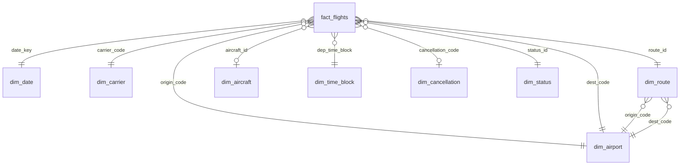

# Airline Operations Analytics

A pipeline that cleans US domestic flight records from the Bureau of Transportation Statistics (BTS) and loads them into a local MySQL star schema (`airline_ops`). The schema is built for SQL analysis, Power BI dashboards and delay-prediction models. Every flight has scheduled and actual times in UTC, so flights can be compared across time zones.

## Data

- Source: BTS On-Time Performance, monthly CSV files, January 2024 to August 2026 (32 months).
- Size: 18,809,411 flights after cleaning (303,116 cancelled, 52,698 diverted, 4,070,423 arrived 15+ minutes late).
- Raw CSVs go in `data/raw/`; they are not committed.

## Getting the raw data

- Source: BTS TranStats, "Reporting Carrier On-Time Performance (1987-present)", with all fields selected. Download one month at a time.
- Save each month in `data/raw/` as `bts_flights_YYYY_MM.csv` (for example `bts_flights_2024_01.csv`). The loader and the verification step read the month from this file name, so keep the pattern exactly.
- Disk space: the `fact_flights` table is about 7.7 GB and the MySQL data directory about 10 GB, plus the raw CSVs and the cleaned Parquet files.

## Schema



`dim_carrier_history` is a standalone reference table with no foreign key. `dim_route` holds `distance_group` (band number 1-11) and `distance_group_label`.

Views (`sql/schema/02_views.sql`):

- `v_flights`: the fact table joined to every dimension with readable names.
- `v_dim_origin_airport`, `v_dim_dest_airport`: two copies of `dim_airport` for Power BI.
- `v_ml_features`: one row per completed flight, with features known before departure and the target `arr_del15`.

Rows and sizes (data + indexes, from `information_schema`):

| Table | Rows | Size |
|---|---|---|
| `fact_flights` | 18,809,411 | 7.66 GB |
| `dim_airport` | 365 | < 0.01 GB |
| `dim_route` | 7,679 | < 0.01 GB |
| `dim_aircraft` | 6,789 | < 0.01 GB |
| `dim_carrier` | 15 | < 0.01 GB |
| `dim_carrier_history` | 2,075 | < 0.01 GB |
| `dim_date` | 1,096 | < 0.01 GB |
| `dim_time_block` | 19 | < 0.01 GB |
| `dim_cancellation` | 4 | < 0.01 GB |
| `dim_status` | 4 | < 0.01 GB |

## Rebuild

Prerequisites:

- Python 3.9 and the packages in `requirements.txt` (`python -m venv .venv && .venv/bin/pip install -r requirements.txt`).
- MySQL 8+ running locally. The loader creates the database (`airline_ops`, or `--database` / `MYSQL_DATABASE`) if it does not exist, so the MySQL user needs the `CREATE` privilege.
- A `.env` file copied from `.env.example` with the connection settings (it is git-ignored). The loader uses `LOAD DATA LOCAL INFILE`, so the server needs `local_infile` enabled: run `SET GLOBAL local_infile = 1;` as an admin, or set `local_infile=1` under `[mysqld]` in `my.cnf` to make it persistent. The loader turns it on for its own client connection (`local_infile=True` in `python/db.py`).
- The raw BTS CSVs in `data/raw/` (see "Getting the raw data").

Run in this order:

```bash
.venv/bin/python python/build_timezones.py   # airport -> IANA time zone lookup (reads data/raw/*.csv)
.venv/bin/python python/clean_data.py        # CSV -> Parquet with UTC columns
.venv/bin/python python/load_mysql.py        # schema, dimensions, all months, verification
```

`load_mysql.py` with no arguments drops and recreates all tables, so it is a full rebuild. Each month takes about 25-45 s and the dimensions about 20 s, so a full rebuild takes roughly 20-25 minutes. At the end it compares per-month counts (rows, cancelled, diverted, delayed) with `docs/cleaning_report.csv` and writes `docs/load_verification.csv`.

`data/lookup/airport_timezones.csv` is committed, so step 1 only needs re-running when new airports appear in the raw data.

To load specific months without a rebuild: `load_mysql.py --months 2025_11,2025_12`. Add `--rebuild` to drop the schema first.

Sanity checks, each with its expected result in a comment:

```bash
mysql -h127.0.0.1 -uroot airline_ops < sql/checks/sanity_checks.sql
```

`sql/checks/ml_view_checks.sql` holds two optional checks on `v_ml_features`. They scan the whole fact table with a window function and need `innodb_buffer_pool_size` of about 1 GB; on the default 128 MB they can wedge the server, so they are not part of `sanity_checks.sql`.

Tests: `.venv/bin/pytest -v`

## Folder layout

```
python/            pipeline scripts (build_timezones, clean_data, load_mysql, dimensions, utc, db, lookups)
sql/schema/        01_create_tables.sql, 02_views.sql
sql/checks/        sanity_checks.sql, ml_view_checks.sql (optional, needs a bigger buffer pool)
data/raw/          BTS CSVs (not committed)
data/processed/    cleaned Parquet files (not committed)
data/lookup/       BTS code lookups and airport time zones
docs/              cleaning, time zone and load verification reports; design spec and plan
tests/             pytest suite
machine_learning/  placeholder for models
powerbi/           placeholder for dashboards
```

## Design notes

- **Star schema.** One fact table with dimensions for date, carrier, airport, route, aircraft, time block, cancellation and status. Foreign keys enforce integrity; airports are keyed by 3-letter code. Dimensions contain only codes that appear in the data, and the load stops if a code is missing from a lookup.
- **UTC timestamps.** Scheduled departure is the local date and time read in the origin airport's time zone. Scheduled arrival is departure plus scheduled elapsed time. Actual times add the reported delays. A self-check converts arrivals back to each destination's local time and compares them with the reported time (any airport under 99% stops the build); results are in `docs/timezone_check.csv`.
- **Rerun-safe loads.** Each month is loaded in one transaction that deletes and reloads that month, and the fact table has a unique natural key, so a repeated or interrupted load does not duplicate rows.
- **Delay NULL/0 rule.** Delay-cause columns are 0 for flights that arrived normally and NULL for cancelled or diverted flights, so `AVG(arr_delay)` skips them automatically.
- **No leakage in ML features.** `v_ml_features` leaves out actual times and `dep_delay`; the previous-leg arrival delay comes from the same aircraft's earlier flight.

## Sanity-check results

Run on the full 32-month load. All matched their expected values except where noted:

- These checks ran and matched: dimension counts (365 airports, 7,679 routes, 15 carriers, 6,789 aircraft), the delay-rule checks, cancelled flights that keep a departure time (11,588), and the January 2024 delayed-arrival share (DL 0.189, AA 0.294).
- `sched_arr_utc <= sched_dep_utc AND crs_elapsed_time > 0`: expected 0, found 0. (The check was narrowed after the full load found 1 row; see the next item.)
- Rows with a missing or non-positive `crs_elapsed_time` (the `CRSArrTime` fallback rows): expected 20, found 20. One of them, YX 5625 MKE to LGA on 2026-06-06, is zero-length in the source data (08:15 Central and 09:15 Eastern are the same UTC instant). BTS measures its own `ArrDelay` from that schedule, so `utc.py` correctly leaves it.
- The two `v_ml_features` checks (row count, and no previous leg without a tail number) were not run: they did not finish within the default 128 MB `innodb_buffer_pool_size`. They now live in `sql/checks/ml_view_checks.sql`, which is optional and needs the bigger buffer pool.

## Known issues

- Keep `data/` out of iCloud's "Optimize Mac Storage" if the project lives in a synced folder such as `~/Documents`. Evicted Parquet files can time out on first read and stop the load.
- MySQL's default `innodb_buffer_pool_size` (128 MB) is small for 18.8M rows; loads and the `v_ml_features` view are slow with it. Raising it to about 1 GB is recommended.
