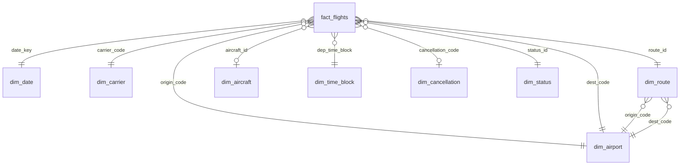

# MySQL Star Schema for Airline Operations Analytics — Design

Date: 2026-11-24
Status: Approved 2026-11-25

## 1. Intent

This is a portfolio project. The MySQL database is its centre and has to support three uses:

1. **SQL practice and showcase**: joins, window functions, CTEs and aggregations over a real dataset of 18.8M rows.
2. **Visualization**: Power BI dashboards (the `powerbi/` folder).
3. **ML exploration**: a flat feature set for delay prediction (the `machine_learning/` folder).

The reader is a reviewer or hiring manager skimming the repo. The schema should look deliberate, fit in one diagram and be explainable in two minutes, and anyone should be able to rebuild it from the scripts.

## 2. Goals, non-goals, anti-goals

**Goals**
- A star schema with one fact table (one row per flight) and conformed dimensions, plus `dim_route` and `dim_aircraft`.
- Correct UTC timestamps for every flight, using an airport → IANA time zone lookup, with a built-in check that proves the time zones are right.
- A fully scripted rebuild: clean → time zones → create schema → load. No hand-edits in MySQL.
- Every load is checked against `docs/cleaning_report.csv` (row counts and status counts).
- An ER diagram and design notes in the repo that a reviewer can read.

**Non-goals (for now)**
- Enriching aircraft with make, model or seat count (FAA registry). `dim_aircraft` leaves room for it.
- Weather or holiday data. `dim_date` leaves room for a holiday flag.
- Table partitioning (see §6.4).
- A SQL staging layer (approach C).
- Loading the 9 lookup tables that don't match a fact column. They stay in `data/lookup/`.
- Writing the analysis queries, dashboards and ML notebooks. Those are follow-up work built on this schema.

**Anti-goals (failure even if it "works")**
- Times that are silently wrong (wrong time zone, wrong arrival date) going into the data.
- A model Power BI fights (ambiguous relationships, a missing date table).
- A schema that only rebuilds by hand.

## 3. Constraints

- **Machine:** macOS with 8 GB RAM. MySQL is not installed yet; the plan is `brew install mysql`, current 8.x/9.x.
- **Python 3.9** in `.venv`: pandas 2.3, pyarrow 21. The standard library's `zoneinfo` plus `tzdata` are available.
- **Source data:** 32 monthly Parquet files in `data/processed/flights/`, 2024-01 to 2026-08, 18,809,411 rows, produced by `python/clean_data.py`.
- **Lookups:** 19 BTS CSVs in `data/lookup/`, each with columns `Code,Description`. `L_AIRPORT*` are cp1252, the rest UTF-8.
- **MySQL can't read Parquet**, so loading goes through CSV and `LOAD DATA LOCAL INFILE`. `local_infile` has to be enabled on both the server and the client.
- **MySQL InnoDB doesn't allow foreign keys on partitioned tables.**

## 4. Approaches considered

| | Approach | Trade-off |
|---|---|---|
| **A** | **Star schema** (chosen) | Native fit for Power BI, readable SQL, easy flat ML view. Shows less normalization theory. |
| B | Fully normalized (3NF: airports → cities → states, etc.) | Best for showing normalization; 4–5 joins per question; Power BI has to undo it. |
| C | Layered staging → core → mart, with ETL in SQL | Most data-engineering signal, but it stores the 18.8M rows twice (5+ GB on an 8 GB machine) and duplicates cleaning that already works in Python. |

**Chosen: A**, with two touches from B: `dim_route` (a route as its own entity) and `dim_aircraft` (built from tail numbers). These add some normalization without hurting the Power BI model.

## 5. Schema

### 5.1 Diagram

`dim_carrier_history` is a standalone reference table, not linked by a foreign key.

### 5.2 `fact_flights` (one row per scheduled flight, 18.8M rows)

| Column | Type | Notes |
|---|---|---|
| `flight_id` | BIGINT UNSIGNED AUTO_INCREMENT PK | surrogate key |
| `date_key` | INT NOT NULL FK → dim_date | `YYYYMMDD` of the scheduled departure, local date |
| `carrier_code` | VARCHAR(3) NOT NULL FK → dim_carrier | `Reporting_Airline` |
| `flight_number` | SMALLINT UNSIGNED NULL | 1 row is blank in the source data |
| `origin_code`, `dest_code` | CHAR(3) NOT NULL FK → dim_airport | |
| `route_id` | INT UNSIGNED NOT NULL FK → dim_route | |
| `aircraft_id` | INT UNSIGNED NULL FK → dim_aircraft | NULL when the tail number is missing (47k rows) |
| `dep_time_block` | CHAR(9) NOT NULL FK → dim_time_block | e.g. `0600-0659` |
| `status_id` | TINYINT UNSIGNED NOT NULL FK → dim_status | |
| `cancellation_code` | CHAR(1) NULL FK → dim_cancellation | NULL unless cancelled |
| `is_cancelled`, `is_diverted` | TINYINT(1) NOT NULL | |
| `crs_dep_time`, `dep_time`, `crs_arr_time`, `arr_time` | SMALLINT NULL | local `hhmm` as BTS reports it (`2400` = midnight). Kept for "local hour" filtering. |
| `dep_hour`, `arr_hour` | TINYINT NOT NULL | scheduled local hour 0–23 |
| `sched_dep_utc`, `sched_arr_utc` | DATETIME NOT NULL | see §6.1 |
| `actual_dep_utc` | DATETIME NULL | NULL when `dep_delay` is NULL. 11,588 cancelled flights did depart the gate and keep a value. |
| `actual_arr_utc` | DATETIME NULL | NULL when `arr_delay` is NULL (cancelled or diverted) |
| `dep_delay`, `arr_delay` | SMALLINT NULL | minutes; negative means early; range −128 to 4,381 |
| `dep_del15` | TINYINT NULL | 0/1; NULL when the flight never departed |
| `arr_del15` | TINYINT NULL | 0/1; NULL when cancelled or diverted |
| `taxi_out`, `taxi_in`, `crs_elapsed_time`, `actual_elapsed_time`, `air_time` | SMALLINT NULL | minutes |
| `distance` | SMALLINT UNSIGNED NOT NULL | miles, as recorded on this flight |
| `carrier_delay`, `weather_delay`, `nas_delay`, `security_delay`, `late_aircraft_delay` | SMALLINT NULL | 0 for normal completed flights; NULL for cancelled or diverted |

**Keys and indexes**
- `UNIQUE (date_key, carrier_code, flight_number, origin_code, dest_code, crs_dep_time)`. This is the natural key; it has 0 duplicates and blocks double loads. MySQL allows several NULLs in a unique index, which covers the 1 blank flight number.
- Secondary indexes: `(origin_code, date_key)`, `(dest_code, date_key)`, `(carrier_code, date_key)`, `(route_id)`, `(aircraft_id, sched_dep_utc)`. The last one is for aircraft rotation and turnaround queries.
- Expected size: about 2.5–4 GB including indexes.

### 5.3 Dimensions

**`dim_date`**: one row per day from 2024-01-01 to 2026-12-31 (full years, so Power BI's time intelligence works).
`date_key INT PK (YYYYMMDD)`, `full_date DATE UNIQUE`, `year`, `quarter`, `quarter_label` (`Q1`), `month`, `month_name`, `month_short`, `year_month` (`2024-01`), `day_of_month`, `day_of_week` (1 = Monday, matching BTS), `weekday_name`, `is_weekend`, `iso_week`. Names come from `L_MONTHS` / `L_WEEKDAYS`.

**`dim_carrier`**: only the carriers that appear in the data (15 today).
`carrier_code VARCHAR(3) PK`, `carrier_name` (from `L_UNIQUE_CARRIERS`).

**`dim_carrier_history`**: reference only, no foreign key.
`carrier_code`, `carrier_name`, `start_year SMALLINT`, `end_year SMALLINT NULL`. Parsed from `L_CARRIER_HISTORY`, e.g. `"Tradewind Aviation (2006 - 2023)"`. PK `(carrier_code, start_year)`.

**`dim_airport`**: only airports that appear in the data (365 today). This is a flattened star dimension; there is no separate state table.
`airport_code CHAR(3) PK`, `airport_name`, `city`, `state_code`, `state_name`, `timezone VARCHAR(40)` (IANA name, e.g. `America/Chicago`).
`city` and `airport_name` are split from the description `"City, ST: Airport Name"`. `state_name` comes from `L_STATE_ABR_AVIATION`.

**`dim_route`**: one row per directed origin → destination pair (7,679 today; ATL→LAX and LAX→ATL are separate rows).
`route_id INT UNSIGNED PK`, `origin_code`, `dest_code` (FK → dim_airport), `route_label` (`ATL-LAX`), `distance_miles` (the latest distance recorded), `distance_group` (250-mile bands from `L_DISTANCE_GROUP_250`). `UNIQUE (origin_code, dest_code)`.

**`dim_aircraft`**: one row per normalized tail number (about 6,790).
`aircraft_id INT UNSIGNED PK`, `tail_number VARCHAR(10) UNIQUE`, `primary_carrier_code` (the carrier with the most flights on this tail; 69 tails flew for more than one carrier), `first_flight_date`, `last_flight_date`, `flight_count`.
Make, model and seats are left out for now (non-goal).

**`dim_time_block`** (19 rows): `block_code CHAR(9) PK`, `block_label` (from `L_DEPARRBLK`), `start_hour`, `end_hour`, `day_part` (`Night` 0–5, `Morning` 6–11, `Afternoon` 12–17, `Evening` 18–23).

**`dim_cancellation`** (4 rows): `cancellation_code CHAR(1) PK`, `reason`.

**`dim_status`** (4 rows): `status_id`, `status_name` (`On Time`, `Delayed`, `Cancelled`, `Diverted`), `sort_order`.

### 5.4 Views

- **`v_dim_origin_airport`, `v_dim_dest_airport`**: `dim_airport` with renamed columns, so Power BI gets two separate airport tables. This avoids the inactive-relationship problem when the same table is linked twice.
- **`v_flights`**: the fact table joined to every dimension with readable names. This is the entry point for ad-hoc SQL.
- **`v_ml_features`**: one row per non-cancelled, non-diverted flight.
  - Features known **before departure**: date parts, `dep_hour`, `day_part`, carrier, origin, destination, distance, route, and the aircraft's previous-leg arrival delay (via a `LAG` over `aircraft_id`, `sched_dep_utc`).
  - Target: `arr_del15`.
  - Actual times and `dep_delay` are left out so that information from after departure doesn't leak into the features.

## 6. Key design decisions

### 6.1 UTC timestamps (from the time zone idea)

- **Lookup:** `data/lookup/airport_timezones.csv` with columns `airport_code,timezone`. It needs one row per airport, not per flight.
  - Source: OpenFlights `airports.dat` (public, about 1 MB, has IANA zone names by IATA code). **The user confirms the download before it happens.**
  - Airports missing from OpenFlights are added by hand, with a comment.
  - The build fails if any airport in the data has no time zone.
- **Computing the timestamps:**
  - `sched_dep_utc` = `FlightDate + CRSDepTime`, read in the origin airport's zone, then converted to UTC.
  - `sched_arr_utc` = `sched_dep_utc + CRSElapsedTime`. This avoids guessing the arrival date for flights that cross midnight.
    - Fallback for the 20 rows where `CRSElapsedTime` is missing (5) or ≤ 0 (15): read `CRSArrTime` in the destination zone on the departure date, adding 1 day if that lands before `sched_dep_utc`. These rows are flagged in the report and left out of the self-check.
  - `actual_dep_utc` = `sched_dep_utc + DepDelay` (NULL if `DepDelay` is NULL).
  - `actual_arr_utc` = `sched_arr_utc + ArrDelay` (NULL if `ArrDelay` is NULL).
  - Timestamps are vectorized per time zone (each zone is converted once over its rows), so the whole dataset takes seconds, not a per-row loop.
- **Self-check:** convert `sched_arr_utc` to the destination airport's zone. The local time must equal `CRSArrTime`, compared modulo 1440 minutes. The match rate per airport is written to `docs/timezone_check.csv`. Any airport below 99% match stops the build; a wrong zone shows up as a whole-hour offset.
- **DST edges:** times that don't exist (spring-forward gap) are shifted forward. Ambiguous times (fall-back hour) use the first occurrence. Both counts go into the cleaning report.

### 6.2 Airport key: the 3-letter code, not the numeric BTS ID
BTS can reassign codes, but that is very unlikely within 2024–2026, and codes make SQL and dashboards readable. If data before 2024 is ever added, re-clean to bring back `OriginAirportID` and switch the key.

### 6.3 Dimensions hold only codes used by the data
This keeps Power BI slicers clean (365 airports, not 6,942). The loader builds the dimensions from the Parquet data joined to the lookups. **If a code is missing from a lookup, the load stops with an error**, rather than a blank name getting through.

### 6.4 Foreign keys instead of partitioning
InnoDB doesn't allow both. Foreign keys enforce integrity and show up in ER diagrams, which matters more for a portfolio. The `(…, date_key)` indexes cover date-range queries.

### 6.5 Delay columns
- 0 means the flight arrived and that cause didn't apply.
- NULL means not applicable (cancelled or diverted).
- `AVG(arr_delay)` therefore skips cancelled and diverted flights automatically. This is documented in a schema comment.

### 6.6 Encoding
`utf8mb4` with collation `utf8mb4_0900_ai_ci` everywhere. The cp1252 airport files are decoded in Python before loading.

## 7. Pipeline changes

| Step | File | Change |
|---|---|---|
| 1 | `python/build_timezones.py` (new) | Download OpenFlights data (after confirmation), write `data/lookup/airport_timezones.csv`, fail on missing airports. |
| 2 | `python/clean_data.py` | Keep `CancellationCode` alongside `CancellationReason`; normalize tail numbers (uppercase, add the `N` prefix when missing); add the 4 UTC columns; run the time zone self-check; record DST edge counts in the report. |
| 3 | `sql/schema/01_create_tables.sql` (new) | Database, tables, keys, indexes, column comments. |
| 4 | `sql/schema/02_views.sql` (new) | The 4 views in §5.4. |
| 5 | `python/load_mysql.py` (new) | Build the dimensions → load them → load the fact table month by month through temporary CSV + `LOAD DATA LOCAL INFILE`. Each month runs in one transaction that deletes and reloads it, so reruns are safe. Then verify against `cleaning_report.csv`. |
| 6 | `docs/` | ER diagram and schema notes in the README. |

New Python dependency: `PyMySQL` (or `mysql-connector-python`), added to a `requirements.txt`. Connection settings come from `.env`, which is already git-ignored.

## 8. Verification

- The row count per month in MySQL equals `Rows_Clean` in `cleaning_report.csv`. Totals of cancelled, diverted and delayed flights match.
- No orphan rows; the foreign keys enforce this.
- The time zone self-check passes (§6.1).
- Sanity queries: on-time % by carrier for January 2024 matches the earlier pandas result (e.g. DL 18.9% delayed, AA 29.4%).
- `sched_arr_utc > sched_dep_utc` for every row.

## 9. Calls made by Claude (for the user to check)

1. 3-letter airport codes as keys (§6.2).
2. OpenFlights as the time zone source; the download still needs the user's yes.
3. Dimensions limited to codes in the data (§6.3).
4. Foreign keys over partitioning (§6.4).
5. `dim_date` covers full years 2024–2026.
6. Route distance = the latest recorded value; each flight keeps its own `distance`.
7. `dim_aircraft.primary_carrier_code` = the carrier with the most flights on that tail.
8. ML target `arr_del15`, with features limited to what is known before departure.
9. `day_part` hour ranges (§5.3).
10. Ambiguous DST times use the first occurrence.
11. Fallback arrival time for the 20 rows with no usable scheduled duration (§6.1).
12. The previous-leg arrival delay in `v_ml_features` counts as "known before departure". Strictly, it's only known once the previous flight lands. It's the standard feature for this kind of model, but it can be dropped for a stricter setup.

## 10. Left to the builder

Exact index names, SQL file layout within `sql/schema/`, the CSV chunk size for loading, the MySQL user and database name (suggested: `airline_ops`), and how progress is logged.
